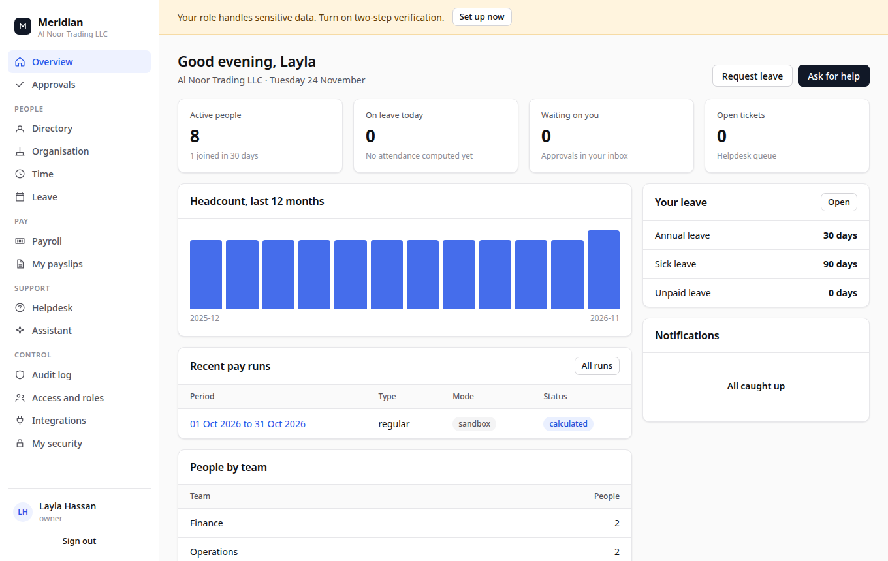
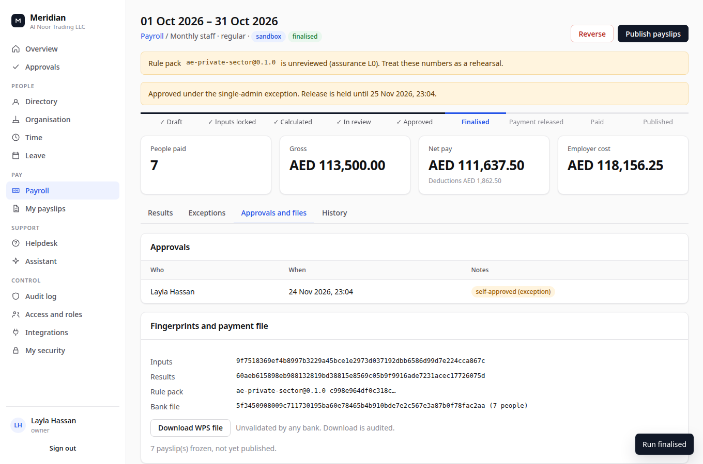
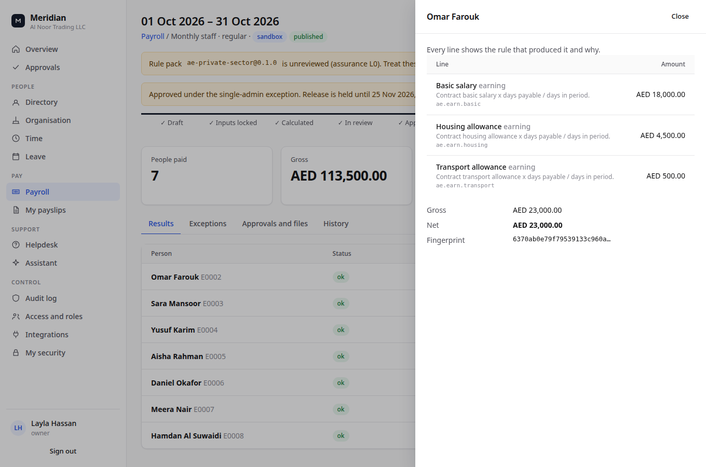
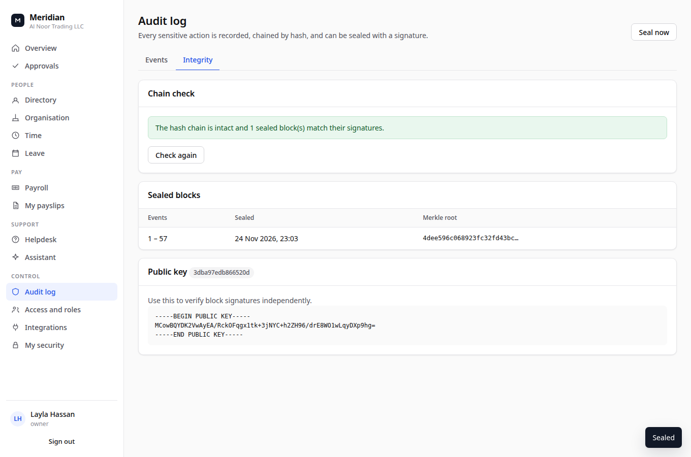
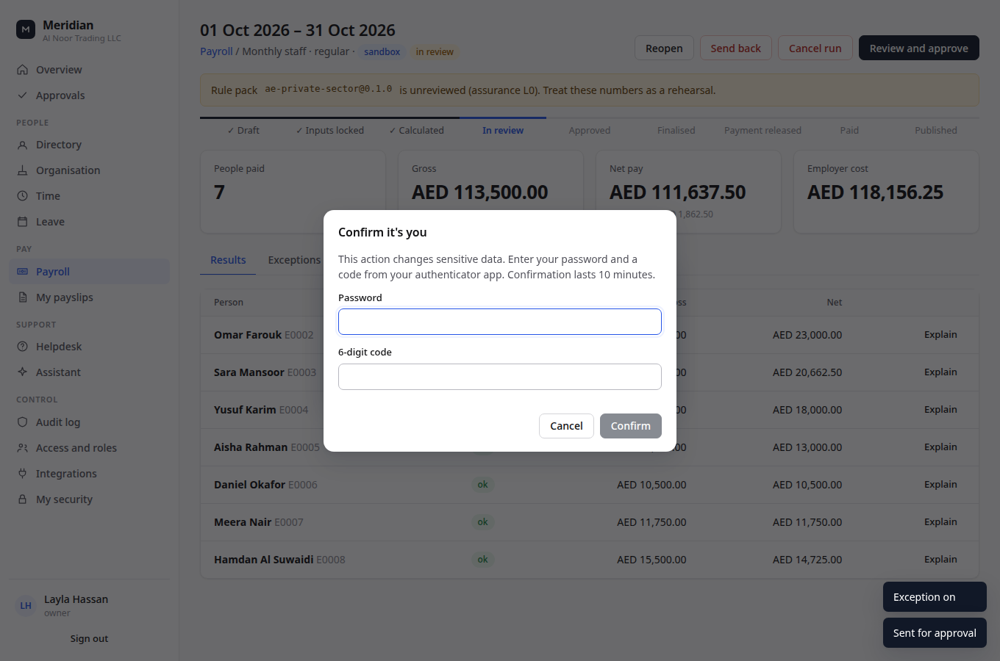
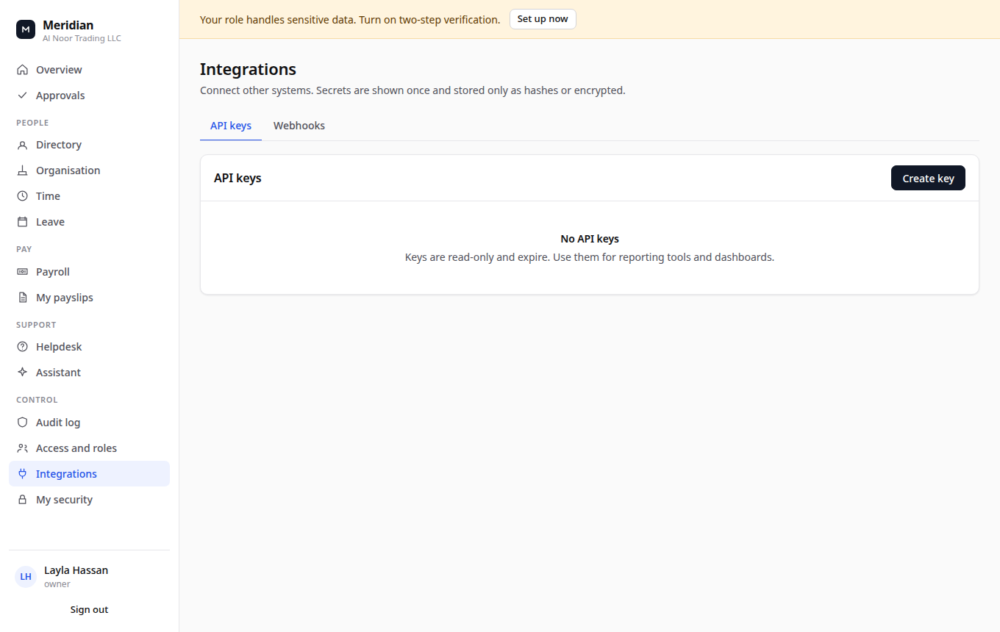

# Meridian

Open-source people and payroll platform. UAE-first (WPS, GPSSA, gratuity), multi-tenant, built around a deterministic payroll engine, an append-only audit trail and a database that enforces tenant isolation itself.

> **Status: working reference implementation, not a production payroll system.** All features below run and are tested, but the UAE rule pack is assurance level **L0** (see [docs/SECURITY.md](docs/SECURITY.md#payroll-assumptions)), the WPS file has not been validated by a bank, and live bank payment is blocked in code until a pack reaches L2. Read the limitations section before pointing this at real salaries.

## What is in the box

| Area | What works |
| --- | --- |
| Identity and access | Registration, scrypt password hashing (N=2^15), account lockout with exponential back-off, sessions with idle and absolute expiry, TOTP MFA with recovery codes, step-up re-authentication for sensitive actions, 7 roles with permission checks on every route, per-user session list and revoke |
| People | Directory, employee records with optimistic concurrency, organisation tree, managers, teams, contract types, termination, field-level reveal of ID and bank data (audited) |
| Time | Attendance, manual punches, shift templates and assignment, public holidays, device ingest with per-device keys, settings |
| Leave | Leave types, balances and entitlements, working-day counting (weekends and holidays), requests, approval routing up the manager chain, calendar |
| Approvals | One approval engine for leave and payroll, content-hash bound decisions, no self-approval, single-admin exception with 24 h release delay (ADR-006) |
| Payroll | Pay groups, one-off adjustments, run lifecycle (draft, calculated, submitted, approved, finalised, published), deterministic calculation with per-line explanations, exceptions that block approval until fixed or waived, WPS SIF export, frozen payslips, rule packs with assurance levels |
| Service | Helpdesk tickets with internal notes, announcements, knowledge base |
| Assistant | Tool-restricted assistant (fixed tools, pseudonymised people, no pay, bank or ID data ever reaches the model) |
| Audit | Hash-chained events, Ed25519-sealed Merkle blocks, integrity verification, public key export |
| Platform | Read-only API keys, signed webhooks with SSRF protection (validated IP is pinned), delivery log, OpenAPI document at `/api/v1/openapi.json` |
| Data protection | Per-employee data keys, field encryption, crypto-erasure on termination request |

## Screenshots

Demo data (a fictional company), captured from the running app.

| | |
| --- | --- |
|  |  |
|  |  |
|  |  |

## Layout

```
packages/engine   deterministic payroll engine and rule packs (integer arithmetic, no floats)
apps/api          Fastify 5 API, PostgreSQL migrations (001-012), outbox worker, seed
apps/web          React 19 + Vite single-page app, own CSS tokens (classic clean white)
docs/             SPEC, ADRs (001-021), research notes, SECURITY, THREAT_MODEL
spec/, tasks/     capability map, plan, todo, progress notes (agent-skills workflow)
scripts/          database bootstrap and reset
```

## Quick start (local development)

Requirements: Node 22+, pnpm, PostgreSQL 16.

```bash
pnpm install
cp .env.example .env                                   # then edit; see below

# 1. Roles (once, as a PostgreSQL superuser). Edit the passwords in the file first.
sudo -u postgres psql -f scripts/db-bootstrap.sql
sudo -u postgres createdb -O meridian_owner meridian

# 2. Schema (runs as meridian_owner), then demo data
pnpm db:migrate
pnpm db:seed                    # prints the demo owner login once

# 3. Run
pnpm --filter @meridian/web build
WEB_DIST=$PWD/apps/web/dist pnpm --filter @meridian/api dev     # http://localhost:8080
```

For front-end work run `pnpm --filter @meridian/web dev` (port 5173, proxies `/api` to 8080).

**A web rebuild needs an API restart** when the API serves `WEB_DIST`, because static file names are registered at startup.

### Environment

| Variable | Purpose |
| --- | --- |
| `DATABASE_URL_OWNER` | migrations only. Never used by the running app |
| `DATABASE_URL_APP` / `_AUTH` / `_WORKER` | three least-privilege roles (see ADR-018) |
| `MERIDIAN_MASTER_KEY` | 32 random bytes, base64. Required in production. Wraps tenant and employee data keys |
| `MERIDIAN_SIGNING_KEY` | 32 random bytes, base64. Ed25519 seed that signs audit blocks. Required in production |
| `COOKIE_SECURE`, `COOKIE_SAMESITE`, `TRUST_PROXY` | set `TRUST_PROXY=true` only behind a proxy you control |
| `OPENAI_API_BASE`, `OPENAI_API_KEY`, `ASSISTANT_MODEL` | optional; without them the assistant answers directly from tool results |

Generate keys with `openssl rand -base64 32`. Losing `MERIDIAN_MASTER_KEY` makes encrypted fields unrecoverable. The master key lives in an environment variable today (ADR-011); a cloud KMS adapter is an open decision (D11).

### Tests

```bash
pnpm typecheck
pnpm test                 # engine (33) + API integration (117), against a real PostgreSQL database `meridian_test`
pnpm audit --prod
```

The API tests need `meridian_test` migrated: `./scripts/db-reset.sh meridian_test`. CI (`.github/workflows/ci.yml`) does the same with a Postgres service.

### Docker

`docker-compose.yml` runs PostgreSQL, the API and the worker for evaluation. The `Dockerfile` has not been built in the environment this was developed in (no Docker daemon available); CI builds it on every push to `main`.

## Production checklist (short)

1. TLS in front; `NODE_ENV=production`; set both keys from a secret manager; `TRUST_PROXY=true` only if the proxy strips client-supplied forwarding headers.
2. Separate database passwords per role; the app roles must not be superusers or have `BYPASSRLS` (the bootstrap script creates them correctly).
3. Run the worker (`node apps/api/dist/worker.js`) as a separate process.
4. Back up the database **and** keep the signing public key somewhere other than the database, so audit blocks can be verified independently.
5. Have the UAE pack reviewed by a qualified payroll or legal reviewer and validated with your bank's WPS channel before enabling live mode. See [docs/SECURITY.md](docs/SECURITY.md).

## Known limitations

- Email is not delivered; action tokens and approval links exist but there is no mail provider.
- No leave proration, no mid-period compensation split, no automatic notice pay, overnight shifts are staged.
- Contractors are excluded from pay runs.
- Passkeys, OIDC/SAML, SCIM, MCP OAuth, Drive/SharePoint connectors, mobile apps, talent and rewards modules, countries other than the UAE, the Rust/WASM engine and edge workers are staged in the blueprint, not built.
- PostgreSQL row-level-security policies have only been reviewed by their author and the test suite. Get an independent review before holding real data.

## Licence

AGPL-3.0-or-later. See `LICENSE`. Architectural decisions are in `docs/adr/`; those marked provisional are assumptions made without an answer from the product owner and are safe to change.
